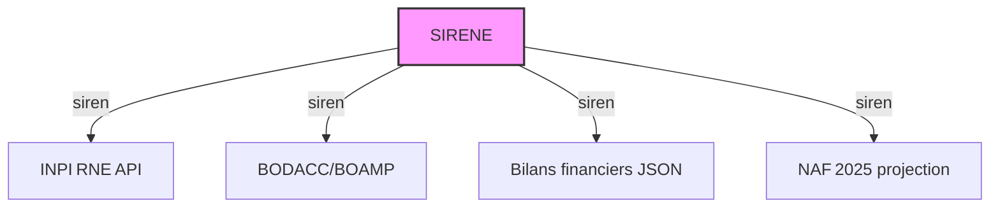

# Idées de liaison de données

## Principales entités et identifiants

- **SIREN** : identifiant unique de l'entreprise (9 chiffres, zéros initiaux conservés).
- **Siret** : identifiant de l'établissement (14 = SIREN + NIC).
- **Activité NAF/APE** : code d'activité principale (versions NAF 2025 en projection via `activitePrincipaleNAF25Etablissement` et `activitePrincipaleNAF25UniteLegale`).
- **Événement juridique** : issu de BODACC/BOAMP ou de l'INPI RNE (type d'événement, date).
- **Bilan financier** : issu des bilans saisis INPI (JSON, champs `m1` = CA, `m3` = résultat, etc.).
- **Géographie** : code commune, code postal, coordonnées Lambert 93 (BAN, COG).

---

## Lien logique entre les sources (Mermaid ER‑diagramme)

```mermaid
erDiagram
    ENTITY Entreprise {
        string siren PK
        string denomination
        string activitePrincipale
    }
    ENTITY Etablissement {
        string siret PK
        string siren FK
        string codeCommuneEtablissement
        string codePostalEtablissement
    }
    ENTITY Evenement_Juridique {
        string siren FK
        date date_event
        string type_event
    }
    ENTITY Bilan_Financier {
        string siren FK
        string exercice
        numeric chiffre_affaires   # champ m1 du bilan saisi
        numeric resultat           # champ m3 du bilan saisi
    }
    ENTITY NAF_2025Projection {
        string siren FK
        string code_naf_2025
    }

    Entreprise ||--|{ Etablissement : "possède"
    Entreprise ||--|{ Evenement_Juridique : " subit"
    Entreprise ||--|{ Bilan_Financier : " renseigne"
    Entreprise ||--|{ NAF_2025Projection : " code activité NAF 2025"
```

---

## Concepts de liaison (texte)

| Liaison | Source → Cible | Clé de jointure |
|---------|----------------|-----------------|
| **SIREN** | SIRENE ⇢ INPI RNE API | `siren` (9 c.) |
| **SIREN** | SIRENE ⇢ BODACC/BOAMP | `siren` (extraction partielle) |
| **SIREN** | SIRENE ⇢ Bilans financiers JSON | `siren` présent dans métadonnées |
| **SIREN** | SIRENE ⇢ NAF 2025 projection | `siren` ↔ `activitePrincipaleNAF25*` |
| **Siret** | SIRENE ⇢ Établissement | `siret` = `SIREN` + `NIC` (14 c.) |
| **Géographie** | Établissement ⇢ BAN / COG | `codeCommuneEtablissement`, `codePostalEtablissement`, coordonnées Lambert 93 |

---

## Visualisations suggérées (Mermaid)

### 1. Diagramme de flux des données



### 2. Flux par entreprise

```mermaid
flowchart LR
    E[Entreprise (siren)] -->|établissement| E1[Etablissement (siret)]
    E -->|événement juridique| E2[Evenement_Juridique]
    E -->|bilan financier| E3[Bilan_Financier]
    E -->|NAF 2025| E4[NAF_2025Projection]
```

### 4. Carte de connectivité (exemple de requête pseudo‑SQL)

```sql
-- Exemple : lister tous les établissements liés à une entreprise donnée
SELECT e.siren,
       et.siret,
       et.codeCommuneEtablissement,
       ev.type_event,
       bf.chiffre_affaires
FROM Entreprise e
JOIN Etablissement et ON et.siren = e.siren
LEFT JOIN Evenement_Juridique ev ON ev.siren = e.siren
LEFT JOIN Bilan_Financier bf ON bf.siren = e.siren
WHERE e.siren = '123456789';
```

---

## Comment utiliser ces idées

1. **Charger** les données brutes (SIRENE CSV, INPI RNE JSON, BODACC extraits, bilans saisis) dans votre entrepôt de données (GCS → Parquet / BigQuery).  
2. **Créer** les tables `entreprise`, `etablissement`, `evenement_juridique`, `bilan_financier`, `naf_2025_projection` en respectant les clés étrangères (`siren`, `siret`).  
3. **Exécuter** les requêtes Mermaid‑inspirées ou traduites en SQL pour produire des rapports, des graphes interactifs ou des tableaux de bord (Power BI, Tableau, Looker, etc.).  
4. **Personnaliser** les diagrammes Mermaid selon vos besoins (ajouter des nœuds « propriétaire », « siège », etc.) ; ils peuvent être rendus directement dans GitHub, MkDocs, ou tout outil de visualisation Mermaid.

---

**Fichier créé** : `DATA_LINKING_IDEAS.md` sur la branche `feat/data-linking-ideas`.  
Vous pouvez maintenantcommencer à ajouter les connecteurs, les tables et à enrichir les diagrammes Mermaid selon l'évolution de vos pipelines de données.
