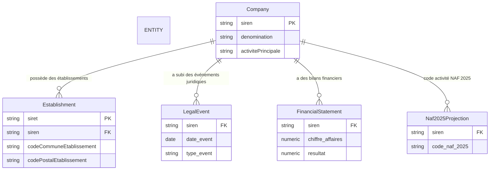
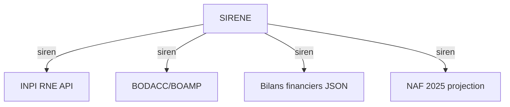

# Idées de liaison de données

## Principales entités et identifiants

- **SIREN** : identifiant unique de l'entreprise (9 chiffres, zéros initiaux conservés).
- **Siret** : identifiant de l'établissement (14 = SIREN + NIC).
- **Activité NAF/APE** : code d'activité principale (versions NAF 2025 en projection via `activitePrincipaleNAF25Etablissement` et `activitePrincipaleNAF25UniteLegale`).
- **Événement juridique** : issu de BODACC/BOAMP ou de l'INPI RNE (type d'événement, date).
- **Bilan financier** : issu des bilans saisis INPI (JSON, champs `m1` = CA, `m3` = résultat, etc.).
- **Géographie** : code commune, code postal, coordonnées Lambert 93 (BAN, COG).

---

## 1. Lien logique entre les sources (Mermaid ER‑diagramme)



**Cardinalités**  

- 1 Company peut avoir **N** Établissement (siège social + zéro ou plusieurs établissements).  
- 1 Company peut avoir **N** LegalEvent (événements successifs dans le temps).  
- 1 Company peut avoir **N** FinancialStatement (bilans annuels).  
- 1 Company peut avoir **N** Naf2025Projection (mise à jour de la.code NAF au fil des nomenclatures).

---

## 2. Concepts de liaison (texte)

| Liaison | Source → Cible | Clé de jointure |
|---------|----------------|-----------------|
| **SIREN** | SIRENE ⇢ INPI RNE API | `siren` (9 c.) |
| **SIREN** | SIRENE ⇢ BODACC/BOAMP | `siren` (extraction partielle) |
| **SIREN** | SIRENE ⇢ Bilans financiers JSON | `siren` présent dans métadonnées |
| **SIREN** | SIRENE ⇢ NAF 2025 projection | `siren` ↔ `activitePrincipaleNAF25*` |
| **Siret** | SIRENE ⇢ Établissement | `siret` = `siren` + `NIC` (14 c.) |
| **Géographie** | Établissement ⇢ BAN / COG | `codeCommuneEtablissement`, `codePostalEtablissement`, coordonnées Lambert 93 |

---

## 3. Visualisations suggérées (Mermaid)

### a) Diagramme de flux des données



### b) Flux par entreprise

```mermaid
flowchart LR
    E[Entreprise (siren)] -->|établissement| E1[Etablissement (siret)]
    E -->|événement juridique| E2[Evenement_Juridique]
    E -->|bilan financier| E3[Bilan_Financier]
    E -->|NAF 2025| E4[NAF_2025Projection]
```

### c) Flux complet incluant la projection NAF 2025

```mermaid
flowchart TD
    Raw[Données brutes (SIRENE CSV, INPI JSON, BODACC)] -->|Extraction| F[Table de liaison (siren)]
    F -->|Jointures| E1[Établissement table]       # siren → siret
    F -->|Jointures| E2[Evenement_Juridique table]
    F -->|Jointures| E3[Bilan_Financier table]
    F -->|Jointures| E4[Naf2025Projection table]   # NAF 2025
```

### d) Requête SQL exemplaire (jointure entreprise ↔ établissement ↔ événements)

```sql
SELECT e.siren,
       et.siret,
       et.codeCommuneEtablissement,
       et.codePostalEtablissement,
       ev.type_event,
       ev.date_event,
       bf.chiffre_affaires,
       bf.resultat
FROM Entreprise e
JOIN Etablissement et ON et.siren = e.siren
LEFT JOIN Evenement_Juridique ev ON ev.siren = e.siren
LEFT JOIN Bilan_Financier bf ON bf.siren = e.siren
WHERE e.siren = '123456789';
```

---

## 4. Comment utiliser ces idées

1. **Charger** les données brutes (SIRENE CSV, INPI RNE JSON, BODACC extraits, bilans saisis) dans votre entrepôt de données (GCS → Parquet / BigQuery).  
2. **Créer** les tables `Company`, `Establishment`, `LegalEvent`, `FinancialStatement`, `Naf2025Projection` en respectant les clés étrangères (`siren`, `siret`).  
3. **Exécuter** les requêtes Mermaid‑inspirées ou traduites en SQL pour produire des rapports, des graphes interactifs ou des tableaux de bord (Power BI, Tableau, Looker, etc.).  
4. **Personnaliser** les diagrammes Mermaid selon vos besoins (ajouter des nœuds « propriétaire », « siège », etc.) ; ils peuvent être rendus directement dans GitHub, MkDocs, ou tout outil de visualisation Mermaid.

## 5. Idées de visualisation pour l'utilisateur

Voici un ensemble d'idées de tableaux de bord /グラフィック que l'utilisateur final pourrait être amené à solliciter, avec pour chaque idée le but, les données clés à afficher et un exemple de code Mermaid (là où cela aide à conceptualiser le tracé).

### a) Sankey des flux de données entre sources
- **But** Montrer comment les données circulent du source brute (SIRENE) vers les enrichissements (INPI, bilans, NAF 2025).
- **Données clés** `source` → `cible` avec un poids proportionnel au nombre d'enregistrements.
- **Exemple Mermaid** :
  ```mermaid
  flowchart TB
    SIRENE -->|siren| INPI
    SIRENE -->|siren| BODACC
    SIRENE -->|siren| BILANS
    SIRENE -->|siren| NAF2025
```
- **Affichage attendu** Un diagramme Sankey où l’épaisseur des flèches reflète le volume d’enregistrements liés.

### b) Heatmap des événements juridiques par trimestre et région
- **But** Visualiser l’intensité des événements (création, radiation, procédure) dans le temps et sur le territoire.
- **Données clés** `date_event` (trimestre), `codeCommuneEtablissement`, `type_event`, nombre d occurrences.
- **Exemple Mermaid** (Mermaid ne gère pas nativement les heatmaps, mais on peut utiliser la syntaxe `pie` ou `graph` pour una représentation simplifiée) :
  ```mermaid
  pie title Événements par trimestre
    "Q1" : 25
    "Q2" : 30
    "Q3" : 20
    "Q4" : 28
  ```

### c) Network graph d’affaires (links entre entreprises via siret / pouvoirs)
- **But** Montrer les relations de propriété, de filiale, de représentant légal.
- **Données clés** `siren`, `siret`, `typeDePersonne`, `actif`, `dateEvenement_pouvoir`.
- **Exemple Mermaid** :
  ```mermaid
  graph TD
    A[Entreprise A] -->|filiale| B[Entreprise B]
    A -->|représentant| C[Personne C]
    B -->|siège| A
  ```

### d) Tableau de bord KPI “Santé financière”
- **But** Donner un aperçu rapide des indicateurs financiers principaux (CA moyen, résultat net, endettement).
- **Données clés** `chiffre_affaires`, `resultat`, `total_actif`, `total_passif` agrégés par `siren`.
- **Suggestion d’outil** Un simple tableau Excel / Power BI avec barres et indicateurs de tendance.

### e) Carte géographique des établissements avec indicateurs superposés
- **But** Voir où se concentrent les activités, les événements ou les difficultés financières sur le territoire.
- **Données clés** `codeCommuneEtablissement`, `libelleCommuneEtablissement`, `chiffre_affaires`, `type_event`.
- **Suggestion d’outil** Mapbox / QGIS / Power BI Maps ; en Mermaid on peut esquemaser le flux :
  ```mermaid
  graph TD
    A[Paris] -->|20 établissements| B["Chiffre d'affaires > 1M€"]
    A-->|5 événements| C["Contentieux"]
  ```

### f) Évolution NAF 2025 au fil du temps
- **But** Suivre la migration des activités vers les nouveaux codes NAF 2025.
- **Données clés** `code_naf_2025`, `date_effet`, `siren`.
- **Exemple Mermaid** (timeline simplifiée) :
  ```mermaid
  timeline
    "2024 Q1" : Migration débutée
    "2024 Q3" : 30 % des entreprises mises à jour
    "2025 Q1" : Profil NAF 2025 pleinement effectif
  ```

---

**Comment exploiter ces idées**

- Commencer par le Sankey (a) pour valider la provenance des données.
- Utiliser la network graph (b) pour détecter les structures de propriété cachées.
- Compléter par le tableau de bord KPI (c) pour un suivi managérial.
- Ajouter la carte géographique (d) pour une dimension spatiale.
- Terminer par l’évolution NAF 2025 (e) pour analyser les changements sectoriels.

---