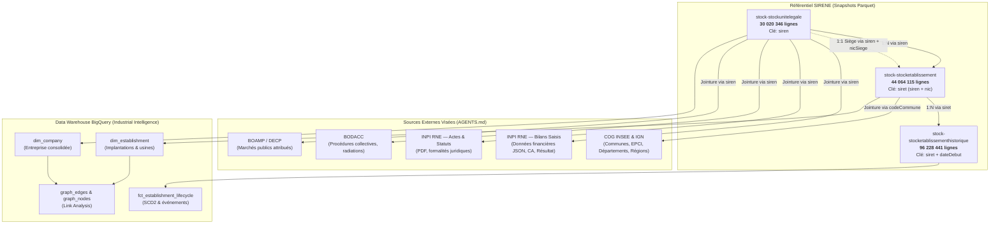

# Architecture des Données : Interconnexions & Modélisation SIRENE

Ce document constitue la référence d'architecture pour l'intégration des données de la base SIRENE (INSEE) dans le Datalake (GCS) et le Data Warehouse (BigQuery) du projet **Industrial Intelligence**, conformément aux principes définis dans [`AGENTS.md`](../../AGENTS.md).

---

## 1. Vue d'Ensemble des Interconnexions

La base SIRENE fournit la structure fondamentale (l'ossature légale et géographique) sur laquelle viennent se greffer toutes les autres sources de données ouvertes françaises :



---

## 2. Interconnexions Internes entre les Fichiers SIRENE

### A. Relation `StockUniteLegale` ↔ `StockEtablissement` (1 à N)
- **Clé de liaison** : `StockEtablissement.siren = StockUniteLegale.siren`
- **Cardinalité** : 1 entreprise possède de 1 à plusieurs centaines d'établissements.
- **Intégrité vérifiée** : 0 doublon de `siren` dans `StockUniteLegale`, 0 doublon de `siret` dans `StockEtablissement`.
- **Règle métier** : Tout établissement appartient obligatoirement à une et une seule unité légale. Le SIRET est strictement composé des 9 chiffres du SIREN complétés par les 5 chiffres du NIC :
  $$\text{SIRET} = \text{SIREN} \parallel \text{NIC}$$

### B. Identification du Siège Social (Relation 1 à 1)
Pour chaque entreprise, le siège social peut être identifié de deux manières parfaitement convergentes :
1. **Depuis l'unité légale** : `siret_siege = StockUniteLegale.siren || StockUniteLegale.nicSiegeUniteLegale`.
2. **Depuis l'établissement** : `StockEtablissement.etablissementSiege = TRUE`.
- **Statistique** : Sur les 44 064 115 établissements, **29 998 675 (68,08%) sont des sièges**, tandis que **14 065 440 (31,92%) sont des établissements secondaires**.

### C. Relation `StockEtablissement` ↔ `StockEtablissementHistorique` (1 à N temporel)
- **Clé de liaison** : `StockEtablissementHistorique.siret = StockEtablissement.siret`.
- **Nature de la modélisation** : **Slowly Changing Dimension Type 2 (SCD2)**.
- **Règle de reconstruction** :
  - La situation courante d'un établissement correspond à la tranche où `dateFin IS NULL`.
  - Pour reconstituer l'historique d'un site industriel (ex: vérifier si une usine textile s'est reconvertie en usine chimique ou a fermé), on filtre sur l'intervalle `[dateDebut, dateFin[`.

```sql
-- Exemple de jointure interne : Unité Légale + Siège Social + Historique des fermetures
SELECT
    ul.siren,
    ul.denominationUniteLegale,
    ul.categorieEntreprise,
    et.siret AS siret_siege,
    et.libelleCommuneEtablissement,
    et.coordonneeLambertAbscisseEtablissement,
    et.coordonneeLambertOrdonneeEtablissement,
    eth.dateDebut AS date_changement_activite,
    eth.activitePrincipaleEtablissement AS ancien_code_naf
FROM read_parquet('stock-stockunitelegale-parquet.parquet') ul
JOIN read_parquet('stock-stocketablissement-parquet.parquet') et
    ON ul.siren = et.siren AND et.etablissementSiege = TRUE
LEFT JOIN read_parquet('stock-stocketablissementhistorique-parquet.parquet') eth
    ON et.siret = eth.siret AND eth.changementActivitePrincipaleEtablissement = TRUE
WHERE ul.etatAdministratifUniteLegale = 'A'
LIMIT 100;
```

---

## 3. Interconnexions Externes avec l'Écosystème du Projet

Conformément à la Section 5 de [`AGENTS.md`](../../AGENTS.md), les données SIRENE constituent la table de vérité pour joindre les autres gisements de données :

### A. Rapprochement avec l'INPI RNE (API & SFTP)
- **Données financières (Bilans saisis JSON)** :
  - Jointure sur le champ `siren` (9 caractères).
  - Permet d'injecter dans la fiche entreprise le chiffre d'affaires, l'EBITDA, le résultat net, l'endettement et le ratio de valeur ajoutée.
- **Documents juridiques & Actes (PDF)** :
  - L'API INPI (`/api/companies/{siren}/attachments`) expose les actes de création, PV d'AG et statuts.
  - **Prudence méthodologique ([`AGENTS.md`](../../AGENTS.md))** : Ne pas confondre dirigeant et actionnaire, ni établissement et filiale. Les participations mentionnées dans les actes historiques nécessitent une traçabilité explicite (date, source et niveau de confiance).

### B. Rapprochement avec le Référentiel Géographique (COG / IGN / BAN)
- **Code Officiel Géographique (COG INSEE)** :
  - Jointure : `StockEtablissement.codeCommuneEtablissement = cog_communes.code_commune`.
  - Permet d'agréger automatiquement par communauté de communes, métropole, département et région.
- **Base Adresse Nationale (BAN)** :
  - Jointure : `StockEtablissement.identifiantAdresseEtablissement = ban.id`.
  - Offre un géocodage de haute fidélité (81,7% des établissements disposent de cet identifiant).

### C. Rapprochement avec BODACC, BOAMP et DECP
- **BODACC (Annonces civiles et commerciales)** :
  - Clé : `siren`. Permet de capturer les procédures de sauvegarde, redressements judiciaires et liquidations en amont de la mise à jour annuelle SIRENE.
- **Marchés publics (DECP / BOAMP)** :
  - Clé : `siret` ou `siren` de l'attributaire du marché. Permet de mesurer l'exposition des industriels à la commande publique.

---

## 4. Modélisation Datalake & Warehouse Cible

```mermaid
flowchart LR
    subgraph Bronze["BRONZE / RAW (GCS)"]
        direction TB
        B1["gs://...-data/raw/sirene/unite_legale/...parquet"]
        B2["gs://...-data/raw/sirene/etablissement/...parquet"]
        B3["gs://...-data/raw/sirene/etablissement_historique/...parquet"]
    end

    subgraph Silver["SILVER (Parquet normalisé GCS / Staging BQ)"]
        direction TB
        S1["stg_sirene_companies<br/>(Typage strict, libellés nettoyés)"]
        S2["stg_sirene_establishments<br/>(Conversion Lambert 93 -> WGS84)"]
        S3["stg_sirene_history<br/>(Filtrage des transitions)"]
    end

    subgraph Gold["GOLD / BIGQUERY ANALYTICS"]
        direction TB
        G1[("dim_company")]
        G2[("dim_establishment")]
        G3[("fct_establishment_lifecycle")]
        G4[("mart_industrial_density")]
        G5[("graph_nodes & graph_edges")]
    end

    Bronze --> Silver
    Silver --> Gold
```



### Règles d'implémentation par couche :

> ℹ️ **Détail d'accès et ingestion** : Pour l'interrogation de l'API data.gouv.fr (`https://www.data.gouv.fr/api/1/datasets/5b7ffc618b4c4169d30727e0/`), l'extraction des empreintes SHA-1 et le script complet de téléchargement en streaming idempotent vers GCS, se référer au guide dédié [`sirene.md`](./sirene.md).

1. **Couche Bronze (GCS Raw Storage)** :
   - Fichiers d'origine immuables stockés sous `gs://industrial-intelligence-dev-data/raw/sirene/snapshot_date=YYYY-MM-DD/`.
   - Conservation des métadonnées de chargement : `source_url`, `checksum_sha1`, `retrieved_at_utc`.
2. **Couche Silver (Normalisation & Qualité)** :
   - Traitement des valeurs nulles textuelles (ex: remplacer les valeurs de substitution `[ND]` de l'INSEE par `NULL`).
   - Normalisation typographique (majuscules, espaces insécables).
   - Conversion géodésique des coordonnées Lambert 93 vers Latitude/Longitude (WGS84).
3. **Couche Gold (BigQuery Dimensions & Graphe)** :
   - `dim_company` : Table dimensionnelle unifiée avec les indicateurs de taille (`categorieEntreprise`), le secteur NAF et la forme juridique.
   - `dim_establishment` : Table dimensionnelle avec champ natif BigQuery `GEOGRAPHY` pour l'analyse spatiale.
   - `fct_establishment_lifecycle` : Table de faits temporelle partitionnée par date.
   - `mart_industrial_density` : Agrégats précalculés par région/département et sous-secteurs industriels (NAF 10 à 33).

---

## 5. Modélisation de Graphe (Link Analysis)

Pour le module d'exploration relationnelle visé par *Industrial Intelligence*, les données SIRENE génèrent les nœuds et arêtes de base :

### Nœuds du Graphe :
- `(:Company {siren: STRING, name: STRING, category: STRING, naf: STRING, status: STRING})`
- `(:Establishment {siret: STRING, is_headquarters: BOOLEAN, address: STRING, postal_code: STRING})`
- `(:Commune {insee_code: STRING, name: STRING, department: STRING, region: STRING})`
- `(:IndustrySector {naf_code: STRING, label: STRING, section: STRING})`

### Arêtes du Graphe :
- `(:Company)-[:HAS_HEADQUARTERS]->(:Establishment)` (1:1)
- `(:Company)-[:HAS_FACILITY]->(:Establishment)` (1:N)
- `(:Establishment)-[:LOCATED_IN]->(:Commune)` (N:1)
- `(:Company)-[:OPERATES_IN]->(:IndustrySector)` (N:1)
- *(À terme avec INPI RNE)* : `(:Person)-[:MANAGES {role: STRING}]->(:Company)`

> ⚠️ **Avertissement méthodologique majeur ([`AGENTS.md`](../../AGENTS.md) Section 5)** :
> Deux entreprises situées à la même adresse (même SIRET ou adresse BAN) ne partagent **pas** nécessairement un lien capitalistique ou de filiale. Ne jamais créer d'arête de propriété (`OWNS` ou `SUBSIDIARY_OF`) sans un acte ou document financier l'attestant formellement.
